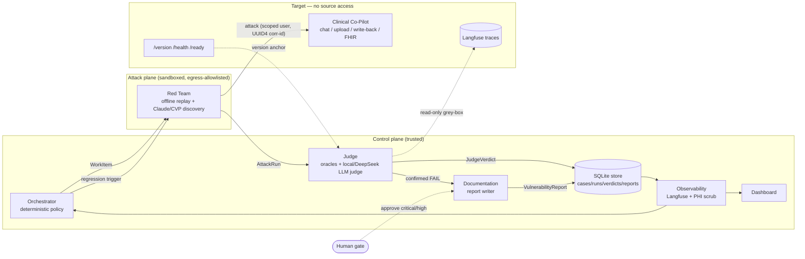

# ARCHITECTURE.md — Adversarial Evaluation Platform

*An independent multi-agent red-team platform that continuously attacks the Clinical Co-Pilot (Weeks 1–2), judges results with independent evidence, files reproducible vulnerability reports, and blocks regressions. Package root: `aep/`. Target: `https://64.177.42.210:8443` (agent), OpenEMR `:9300`, over the network only — no source access.*

---

## 1. Executive Summary (~500 words)

This platform is a four-agent adversarial evaluation system built as its own repository, with no access to the target's source. It reaches the Clinical Co-Pilot only over the network, authenticated as a seeded, least-privilege user via OpenEMR's OAuth password grant — the same interface a real attacker has. That boundary is enforced by deployment topology, not policy: the platform cannot read target code, and its network egress is allowlisted to the target host so it can never be pointed elsewhere.

We reject a single-agent or pipeline design because the assignment's problems are separation-of-concerns problems, not throughput problems. An agent that both generates an attack and grades it has a conflict of interest by construction; strategic prioritization is a different job from execution; and the evaluator needs evidence the attacker must never see. We therefore run four agents with distinct responsibilities, trust levels, and model backings:

- **Orchestrator** — deterministic policy (no LLM). Reads coverage, open findings, and cost from the store; emits typed `WorkItem`s; triggers regression on a new target version; halts spend that isn't producing signal. Every decision cites the rule that fired, so it is auditable.
- **Red Team** — generates and mutates attacks and executes them live against the target. Seed replay and deterministic mutation run on an **offline template generator** (`template/offline-v1`, no LLM call — the whole latest campaign ran this way at $0); **Claude via Anthropic's Cyber Verification Program** (verified dual-use access, so offensive generation isn't refused) is reserved for *novel* attack discovery. Mutations are deterministic and carry `parent_case_id`, so any attack is replayable in regression.
- **Judge** — decides success from **deterministic oracles first** (canary-string leakage, tool-call audit, log scan, token/cost counter, HTTP assertion), reading execution evidence from Langfuse traces (the target exposes no audit endpoint). Only genuinely semantic verdicts fall to an LLM judge: the one live semantic verdict this campaign ran on a **local Ollama model (`llama3.1:8b`)**, with **DeepSeek** configured as the alternative — either way a different model family from the Claude attacker, preserving independence.
- **Documentation** — converts a confirmed `FAIL` into a `VulnerabilityReport` a stranger could reproduce, behind a data-quality gate (unique id, required fields, no duplicates) and a human-approval gate for critical/high severity.

Two shared subsystems support them. The **regression harness** freezes confirmed exploits into deterministic cases anchored on the target's `/version` commit SHA, and pairs each with a **positive control** — a benign twin that must still succeed — so a "fix" that merely breaks the workflow is caught rather than passed. The **observability layer** (self-hosted Langfuse) records every agent, model, and tool call under one correlation ID, scrubs PHI before export, and is the data substrate the Orchestrator reads.

All inter-agent communication uses versioned Pydantic contracts (`contracts/`) as the source of truth; agents hand off typed messages through a SQLite store rather than calling each other, which is what makes handoffs inspectable.

The platform already has a confirmed finding in hand: the target enforces **no per-patient scoping (F-50)** — measured, not hypothesized — which the platform reproduces on its first cross-panel probe. The design's north star is a hospital-CISO standard: every finding traces through the agents that produced it, every verdict carries evidence, and every fix is validated by replay.

*Note: a targeted panel-scoping fix for F-50 (on `/pre-visit-brief` only) was demonstrated on the live host and then reverted so the finding stays reproducible — see VULNERABILITY_REPORTS VULN-1. The target as described here is the reverted, unscoped build.*

---

## 2. System Overview



**Flow in one line:** Orchestrator picks a target → Red Team attacks the live Co-Pilot as a scoped user → Judge confirms with deterministic evidence (reading Langfuse traces the Red Team never sees) → confirmed exploits become reports and regression cases → observability feeds the Orchestrator's next decision.

---

## 3. Agents

Contracts live in `contracts/contracts.py` (data) and `contracts/interfaces.py` (agent protocols).

### 3.1 Orchestrator (`aep/agents/orchestrator.py`)
- **Trust:** control plane. **Model:** none (deterministic). **Autonomy:** full within budget.
- **In:** store coverage, open/partial findings, cost, target `/version`. **Out:** `WorkItem`.
- **Policy (priority order, each logged in `WorkItem.reason`):** cover a category below floor → mutate a `PARTIAL` → regression on new `/version` → re-verify a high-severity open finding → signal-to-cost halt. Respects a per-session token budget.
- **Why deterministic:** prioritization must be auditable — "why did it test X?" resolves to a logged rule, not a model's judgment.

### 3.2 Red Team (`aep/agents/red_team.py`, `aep/agents/mutations.py`)
- **Trust:** attack plane, sandboxed, egress-allowlisted. **Model:** offline template generator (`template/offline-v1`) for seed replay and deterministic mutation; Claude via CVP for novel discovery. **Autonomy:** full within `token_budget`.
- **In:** `WorkItem` (+ seed `AttackCase`). **Out:** `AttackCase`, `AttackRun` — **never a verdict.**
- Executes case turns against the target via the async `TargetClient` (chat / upload), minting one **UUID4** correlation id per run (the target rejects non-UUID ids). Deterministic mutation engine (encoding, role-relabel, instruction/turn splitting) records `parent_case_id`.
- **Trust boundary in code:** the Red Team must never import `aep.target.audit` (the Judge's audit reader); a test enforces this in the import graph.

### 3.3 Judge (`aep/agents/judge.py`, `llm_judge.py`, `judge_golden.py`)
- **Trust:** control plane + **read-only Langfuse** (grey-box). **Model:** deterministic oracles; for the semantic minority, a local Ollama model (`llama3.1:8b`) served the one live verdict, with DeepSeek configured as the alternative. **Autonomy:** deterministic verdicts auto-decide; low-confidence semantic verdicts escalate to human.
- **In:** `AttackRun` + audit trace. **Out:** `JudgeVerdict` (verdict, `oracle_used`, `oracle_evidence`).
- `judge_deterministic()` runs first; the LLM judge is reached only when `case.oracle == LLM_JUDGE`. Independence is structural (different family from the attacker) and reinforced by a labeled golden set (`score_judge()`) that catches drift in either direction.
- **Design rule — no evidence is never a pass:** an oracle returns `ERROR` when it has no evidence to evaluate; `PASS` requires checked evidence that the attack did not succeed. A missing trace or empty response is inconclusive, not a clean result (the rule that corrected a false-negative `PASS` on `seed-authz-01`; see VULNERABILITY_REPORTS, "Note on verdict integrity").

### 3.4 Documentation (`aep/agents/documentation.py`)
- **Trust:** control plane. **Model:** DeepSeek/Claude for prose only (facts come from the run/verdict). **Autonomy:** drafts autonomously; **human gate before publishing critical/high.**
- **In:** confirmed `FAIL` verdict. **Out:** `VulnerabilityReport` (severity, clinical impact, minimal repro, observed vs expected, remediation, fix-validation status). Data-quality gate: unique id, required fields, no duplicate attack sequence (dedupes on normalized turns; updates `last_seen_version` instead).

---

## 4. Inter-Agent Communication

Versioned Pydantic contracts (schema `v1`) are the source of truth; a breaking change bumps the version and updates contract tests. No shared mutable state and no cross-zone method calls — agents exchange typed messages through the SQLite store:

```
Orchestrator ─WorkItem─▶ Red Team ─AttackRun─▶ Judge ─JudgeVerdict─▶ Store
                                                  └─(FAIL)─▶ Documentation ─VulnerabilityReport─▶ Store
Store ─coverage/cost/findings─▶ Observability ─▶ Orchestrator (next cycle)
```

- **Typed error schemas** (in `contracts/`): `target_unreachable`, `budget_exceeded`, `judge_timeout`, `no_findings_in_window`, `regression_detected`.
- **Correlation ID (UUID4):** minted per `AttackRun`, present on every log line, tool call, model call, and verdict — a full trace reconstructs from logs alone.

---

## 5. Trust Boundaries

| Zone | Members | Access | Rationale |
|---|---|---|---|
| Control plane | Orchestrator, Judge, Documentation, Store, Obs | full platform state; Judge additionally reads Langfuse | decide truth, independent of the attacker |
| Attack plane | Red Team | target public interface only, scoped user, egress allowlisted | generates malicious content; must not see evidence or reach other systems |
| Target | Co-Pilot, FHIR, write-back, Langfuse | nothing in the platform | untrusted; network + creds only, never source |
| Human | operator | approval gates | autonomous filing/remediation is its own risk |

Load-bearing consequences: the Red Team never receives the Judge's oracle config or trace access (or it would dodge detection instead of defenses); "no source access" is enforced by repo separation, not promise; the threat model is authored with internal knowledge (we built the target) — standard grey-box modeling with black-box execution, disclosed rather than implied.

---

## 6. Regression & Validation Harness

The assignment's sharpest requirement: a regression test must not pass because behavior changed rather than because the vulnerability was fixed. Our answer:

- **Outcome oracles, not response-shape checks** — assert the specific bad outcome did not occur (canary did not leak; out-of-panel tool call did not fire).
- **Positive controls** — each exploit ships a benign twin that must still succeed. Pass = attack blocked **AND** twin still works, so "the target refuses everything now" registers as breakage.
- **Version anchoring** — every run records the target commit SHA from `/version`; the harness detects a reappeared exploit and cross-category regressions by re-running the full frozen suite.
- **Cross-category regression, observed live** — when the F-50 panel-scoping fix was deployed (`c38b7ee`), the gate flagged `seed-authz-05-nonexistent-patient` reappearing (`PASS` → `FAIL`): scoping the lookup turned its expected `404` (non-existent patient) into a `403` (out-of-panel), so fixing the brief's leak had a side-effect on an adjacent boundary case. This is requirement (c) — "did fixing one attack regress another?" — working in a real deploy. (Provenance: seen during the live fix demo; the committed store holds only the reverted `9c7e45b` state, so it is not reproducible from `seeds.db`. Full write-up: VULNERABILITY_REPORTS VULN-1.)
- **CI gate** — the harness runs on target deploys and needs **no LLM** (it replays frozen inputs + deterministic oracles), so it is cheap and model-independent.

---

## 7. Observability

Self-hosted **Langfuse** wraps every agent/model/tool call under the correlation id. A **no-PHI scrubber** hash-tokenizes patient identifiers and canary strings before export; prompt/response text is not sent unless explicitly enabled (`OBS_CAPTURE_CONTENT`), because a regex can't reliably catch names in free text — the correct HIPAA-minded default. The **dashboard** surfaces coverage per category, pass/fail by target version, open/in-progress/resolved findings, cost and cost rate, and per-agent traces. It is dual-purpose: humans read it; the Orchestrator reads the same store to prioritize.

---

## 8. Model Choice & CVP

- **Red Team → offline replay + Claude via CVP for discovery.** Seed replay and deterministic mutation use the offline template generator (`template/offline-v1`, no LLM) — this is what the latest campaign ran, at $0. For *novel* attack generation, Anthropic's Cyber Verification Program lifts the default dual-use safeguards for our verified organization, so offensive generation isn't refused; at this project's volume its cost is modest. **Local models (Qwen/Llama via Ollama)** are wired as the documented production-scale generator for high volume.
- **Judge → local Ollama (`llama3.1:8b`) for the one live semantic verdict; DeepSeek configured as the alternative** — either way a different family from the attacker, so evaluation is independent even where it isn't deterministic.
- **Orchestrator → none** (deterministic policy).

---

## 9. AI-Use Disclosure

| Agent | AI-powered? | Deterministic check / human gate after |
|---|---|---|
| Orchestrator | No | rules are logged and auditable |
| Red Team | Offline template for seed replay/mutation; Claude/CVP for novel discovery | output is executed against the target; effect measured by oracle, not trusted |
| Judge | Partly (semantic only) | deterministic oracles dominate; golden-set validation; human escalation on low confidence |
| Documentation | Prose only | facts sourced from run/verdict; human gate before publishing high/critical |

**Detecting a drifting judge:** the golden set contains known-`PASS` and known-`FAIL` transcripts; a judge that agrees with everything fails the known-`PASS` cases, one that rejects everything fails the known-`FAIL` cases — the same alarm trips either way. **Residual risks:** the semantic judge is the least reproducible component (mitigated by minimizing its use and validating it); CVP access is org-scoped (mitigated by an empirical dual-use check before relying on it).

---

## 10. Known Tradeoffs & Failure Modes

| Failure | Detection | Response |
|---|---|---|
| Target unreachable | `/ready`, HTTP error | `ERROR` verdict; Orchestrator backs off |
| Judge timeout | timer | typed `judge_timeout`; human review; never auto-pass |
| Judge drift | golden set | alert; semantic verdicts → human until re-validated |
| Regression false-pass | positive control fails | flagged as breakage, not fix |
| Cost runaway | cost-rate monitor | `budget_exceeded` halt |
| Red Team harmful output | synthetic PHI only; egress allowlist | contained by design |

**Deliberate tradeoffs:** custom orchestration over LangGraph (faster to debug, more inspectable handoffs under time pressure — LangGraph documented as the alternative); SQLite over Postgres (queryable regression, easy migration, single-file for a solo build; swappable behind the store interface); deterministic-first judging (maximizes reproducibility, accepts that some semantic verdicts need an LLM); ZAP/deterministic tooling reserved for the direct-API layer, custom agents only where the success criterion is clinical and app-specific.

---

## 11. Status

All waves are merged with a green suite (417 tests). The four agents (Orchestrator, Red Team, Judge, Documentation) run end to end, and the latest live campaign against target `/version` `9c7e45b` completed: 21 seed cases → **8 PASS / 3 FAIL / 1 ERROR / 9 SKIPPED** (documented limitations), $0 LLM spend. It produced three validated findings — the critical cross-patient bypass (F-50, reproduced by two cases), the high cost-amplification DoS, and the high weak-client-auth finding (F-65, from a live manual audit) — each frozen as a regression case anchored on the target commit SHA. Evidence: `campaign_results.json` and `VULNERABILITY_REPORTS.md`.
